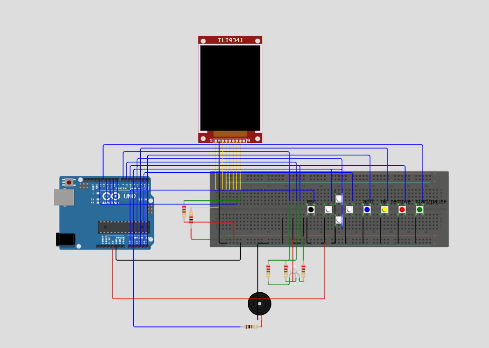
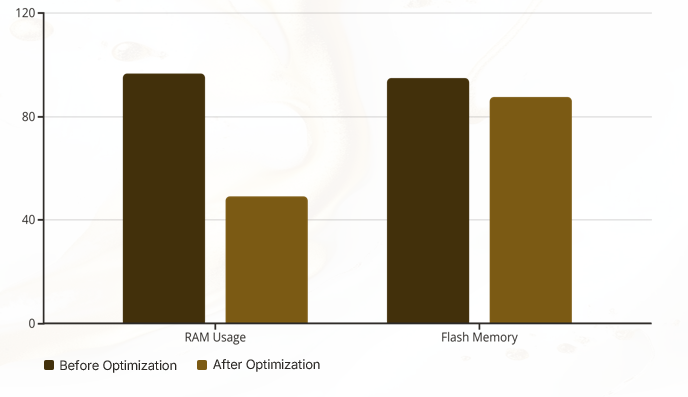

<div align="center">


# ⏳ Project Chronos
### *Belonging to Time* — Multi-Timer & Stopwatch System

[](src/main.cpp)
[](platformio.ini)
[](src/main.cpp)
[](diagram.json)
[](#%EF%B8%8F-hardware--power-architecture)

<br />


**Introduction to Engineering Project — Université Antonine**  
**By:** Abdallah Doughman, Jawad Atriss, Roni Abi Jomaa, Adam Ibrik

</div>

---

## 📖 Overview

Everyday workflows frequently require managing multiple countdown timers and stopwatches simultaneously, yet existing dedicated timers are often either limited to a single channel or overly complex to operate.

**Project Chronos** solves this by providing an intuitive, dependable, solar-rechargeable **multi-timer and stopwatch device** built around the **Arduino UNO R3** and a **2.8" ILI9341 TFT LCD (240×320)**. Designed and simulated digitally using **Wokwi** and **PlatformIO** in VS Code before physical assembly, Project Chronos delivers simultaneous time tracking, real-time visual and audible status alerts, and a clean on-screen menu interface.

---

## ✨ Key Features

- ⏱️ **3 Simultaneous Independent Timers** — Run up to three timers concurrently on a single unified view, each capable of counting down (`HH:MM:SS`) and tracking elapsed stopwatch time (`HH:MM:SS`).
- 🎯 **Digit-by-Digit Precision Editing** — Intuitive 9-button hardware interface allowing seamless selection and modification of individual hours, minutes, and seconds digits with automatic bounds validation (`00:00:00` to `99:59:59`).
- 💡 **RGB LED Status Indicators** — Real-time visual feedback indicating system state:
  - 🟢 **Green**: One or more timers actively running
  - 🔴 **Red**: Countdown timer expired (pulses for 1.2s upon completion and remains red while triggered)
  - 🔵 **Blue**: Idle state or Menu open
- 🔔 **Audible Piezo Alerts** — Plays a `1.2 kHz` alert tone via the active buzzer when any countdown reaches zero.
- 🖥️ **Interactive Multi-Page GUI & Theme Support** — Features an on-screen Main Menu and Settings suite including **Light/Dark Mode inversion** (Gold vs. Midnight Blue theme), Quick Start **Help**, **About Us**, **Contact Us**, and one-click software **Restart**.
- ⚡ **Dirty-Flag Display Optimization** — Tracks state deltas per timer (`lastRemainingSec`, `lastStopwatchSec`, `lastSelected`, `lastEditing`) to redraw only modified screen regions, eliminating screen flicker and reducing RAM usage by ~50%.
- ☀️ **Self-Sustaining Solar Power System** — Powered by dual `0.3 W` solar panels in series charging a `2000 mAh` 18650 Li-ion battery via a `TP4056` controller and stepped up to `7–7.5 V` with a DC-DC boost converter.

---

## 🎮 User Interface & Controls

### 9-Button Control Layout

| Button | Pin | Primary Action (Main View) | Edit Mode Action | Menu / Settings Action |
| :--- | :---: | :--- | :--- | :--- |
| **Add (`+`)** | `A5` | Add a new timer (up to 3 max) | *Disabled* | — |
| **Remove** | `3` | Delete the currently selected timer | *Disabled* | — |
| **Start / Pause** | `12` | Toggle Run / Pause on selected timer | *Disabled* | — |
| **OK** | `2` | Enter Edit Mode on selected timer | — | Select highlighted menu option / Toggle theme |
| **ESC** | `A0` | Open Main Menu | Save digits & exit Edit Mode | Return to previous page / Close Menu |
| **Up (`▲`)** | `A1` | Select previous timer | Increment selected digit (`0–9` / `0–5`) | Move selection cursor up |
| **Down (`▼`)** | `A2` | Select next timer | Decrement selected digit (`0–9` / `0–5`) | Move selection cursor down |
| **Left (`◀`)** | `A3` | Select previous timer | Move cursor to previous digit (`HH:MM:SS`) | — |
| **Right (`▶`)** | `A4` | Select next timer | Move cursor to next digit (`HH:MM:SS`) | — |

---

## 🛠️ Hardware & Power Architecture

### Bill of Materials (BOM)

| # | Component | Specifications & Role |
| :-: | :--- | :--- |
| **1** | **Arduino UNO R3 (CH340)** | ATmega328P MCU, 16 MHz, 5V logic, 7–12V `VIN` input (~50–55 mA) |
| **2** | **2.8" TFT LCD Module (ILI9341)** | 240×320 resolution, SPI interface, 5V/3.3V logic, up to 150 mA |
| **3** | **Active Piezo Buzzer** | 3.3–5V operating voltage (~30 mA), audible countdown completion alert |
| **4** | **RGB LED** | Common-anode status indicator (~20–60 mA depending on brightness) |
| **5** | **Push Buttons (×9)** | Tactile 6mm buttons wired to GND using internal `INPUT_PULLUP` resistors |
| **6** | **Resistors** | `10 kΩ`, `1 kΩ`, `220 Ω`, `110 Ω` / `100 Ω` for voltage limiting & current protection |
| **7** | **Solar Panels (×2)** | `0.3 W` (`3 V`, `100 mA` each) wired in series to produce `5–6 V` in sunlight |
| **8** | **TP4056 Charge Controller** | 1A Lithium-ion battery charger module with load protection (`IN±`, `BAT±`, `OUT±`) |
| **9** | **18650 Li-Ion Battery** | `3.7 V` nominal, `2000 mAh` rechargeable energy storage cell |
| **10** | **DC-DC Boost Converter** | Adjustable step-up module boosting `3.7 V` battery output to `7–7.5 V` for Arduino `VIN` |
| **11** | **Breadboard & Jumpers** | 830 tie-point solderless breadboard with male-to-male / male-to-female jumpers |

### Solar Power Chain

```
[ Solar Panel 1 (3V, 0.3W) ] + [ Solar Panel 2 (3V, 0.3W) ]  (In Series: ~5–6V)
                               │
                               ▼ (IN+ / IN-)
                  [ TP4056 Charge Controller ] ◄───► [ 18650 Li-Ion Battery (3.7V, 2000mAh) ]
                               │
                               ▼ (OUT+ / OUT-)
                  [ Adjustable Boost Converter ]     (Stepped up to 7.0V – 7.5V)
                               │
                               ▼ (VIN & GND)
                      [ Arduino UNO R3 ]             (5V Regulated Rail to TFT, LED & Buzzer)
```

---

## 🔌 Circuit Schematic & Pinout

<div align="center">
  
  <p><em>Figure 1: Schematic representation of Project Chronos in Wokwi Simulator.</em></p>
</div>

### Complete Pin Mapping (`src/main.cpp` & `diagram.json`)

| Subsystem | Component Pin | Arduino UNO Pin | Signal Type / Notes |
| :--- | :--- | :---: | :--- |
| **ILI9341 TFT LCD** | `CS` | `10` | SPI Chip Select |
| | `DC` (`D/C`) | `9` | SPI Data / Command |
| | `RST` | `8` | Display Reset |
| | `MOSI` (`SDI`) | `11` | Hardware SPI MOSI |
| | `SCK` | `13` | Hardware SPI Clock |
| **RGB LED** | `Red` | `7` | Digital Output (Active LOW) |
| | `Green` | `6` | Digital Output (Active LOW) |
| | `Blue` | `5` | Digital Output (Active LOW) |
| **Audio** | `Buzzer (+)` | `4` | Digital PWM / `tone()` Output |
| **Control Buttons** | `Button OK` | `2` | `INPUT_PULLUP` (Active LOW) |
| | `Button Remove` | `3` | `INPUT_PULLUP` (Active LOW) |
| | `Button Start/Pause` | `12` | `INPUT_PULLUP` (Active LOW) |
| | `Button ESC` | `A0` | `INPUT_PULLUP` (Active LOW) |
| | `Arrow Up` | `A1` | `INPUT_PULLUP` (Active LOW) |
| | `Arrow Down` | `A2` | `INPUT_PULLUP` (Active LOW) |
| | `Arrow Left` | `A3` | `INPUT_PULLUP` (Active LOW) |
| | `Arrow Right` | `A4` | `INPUT_PULLUP` (Active LOW) |
| | `Button Add` | `A5` | `INPUT_PULLUP` (Active LOW) |

---

## 📊 Software Architecture & Optimization

### Core Timer State Structure

Each timer slot in `timerArr[3]` is managed by a static `TimerData` struct with dirty-flag tracking to avoid expensive full-screen SPI redraws:

```cpp
struct TimerData {
  uint8_t digits[6];                    // Editable HH:MM:SS digits
  unsigned long remainingMillis;        // Active countdown time remaining
  unsigned long stopwatchElapsedMillis; // Active stopwatch elapsed time
  unsigned long lastUpdateMillis;       // Last loop timestamp for delta calculation
  bool running;                         // Running/Paused state
  bool editing;                         // Digit edit mode active
  int editDigit;                        // Currently selected digit (0-5)
  bool triggered;                       // Countdown completion alert flag
  // Dirty-flag cache fields to prevent redundant SPI TFT redraws:
  bool lastSelected, lastEditing, lastRunning, lastTriggered;
  unsigned long lastRemainingSec, lastStopwatchSec;
  int lastEditDigit;
};
```

### Memory & Performance Optimization

By migrating static UI strings to Flash memory using the `F()` macro, eliminating dynamic heap allocations, and introducing dirty-flag display rendering, **RAM usage was cut nearly in half** (from ~98% down to ~49%) while also reducing Flash footprint:

<div align="center">
  
  <p><em>Figure 2: Memory footprint comparison before and after code optimization.</em></p>
</div>

---

## 🚀 Getting Started (Build & Simulation)

### Prerequisites
- [Visual Studio Code](https://code.visualstudio.com/)
- [PlatformIO IDE Extension](https://platformio.org/)
- [Wokwi for VS Code Extension](https://marketplace.visualstudio.com/items?itemName=Wokwi.wokwi-vscode)

### 1. Clone the Repository
```bash
git clone https://github.com/abd-6668/ProjectChronos.git
cd ProjectChronos
```

### 2. Build the Firmware
Compile the project using PlatformIO CLI or the VS Code status bar:
```bash
pio run -e uno
```
This compiles `src/main.cpp` and outputs `.pio/build/uno/firmware.elf` and `.pio/build/uno/firmware.hex`.

### 3. Run in Wokwi Simulator
1. Open the Command Palette in VS Code (`Ctrl+Shift+P` / `Cmd+Shift+P`).
2. Select **Wokwi: Start Simulator**.
3. Interact with the 9 pushbuttons on the virtual breadboard to add, edit, and run timers in real time.

---

## 📁 Repository Structure

```text
ProjectChronos/
├── assets/                     # Project logos, Wokwi schematic, and optimization charts
├── include/                    # Header files directory
├── lib/
│   └── bmp/
│       └── bmp.h               # Lightweight BMP placeholder helper for ILI9341 TFT
├── src/
│   └── main.cpp                # Core application firmware (UI state machine, timers, I/O)
├── test/                       # PlatformIO unit test directory
├── diagram.json                # Wokwi hardware circuit definition and wiring layout
├── platformio.ini              # PlatformIO build configuration and library dependencies
├── wokwi.py                    # Post-build helper script
├── wokwi.toml                  # Wokwi simulator firmware path configuration
└── README.md                   # Project documentation
```

---

## 🔮 Future Recommendations

1. **Further Code & Memory Optimization** — Continue modularizing UI drawing routines and state management.
2. **Hardware Debouncing** — Add RC filter networks or Schmitt triggers alongside software edge-detection for ultra-reliable button response.
3. **Persistent Storage (EEPROM)** — Save active presets and theme preferences across power cycles.
4. **Custom PCB & Enclosure** — Transition from a solderless breadboard to a custom printed circuit board and 3D-printed housing.
5. **RTC Integration** — Complete the *"Current Time"* and *"History"* features using the `RTClib` dependency.

---

## 👥 Project Team & Credits

Developed at **Université Antonine** (*Introduction to Engineering Project*):

| Team Member | Role |
| :--- | :--- |
| **Abdallah Doughman** | Lead Software Engineer |
| **Jawad Atriss** | Lead Hardware Engineer |
| **Roni Abi Jomaa** | Software & Hardware Engineer |
| **Adam Ibrik** | Testing & Quality Assurance |

📧 **Support & Inquiries:** [help.projectchronos@gmail.com](mailto:help.projectchronos@gmail.com)
